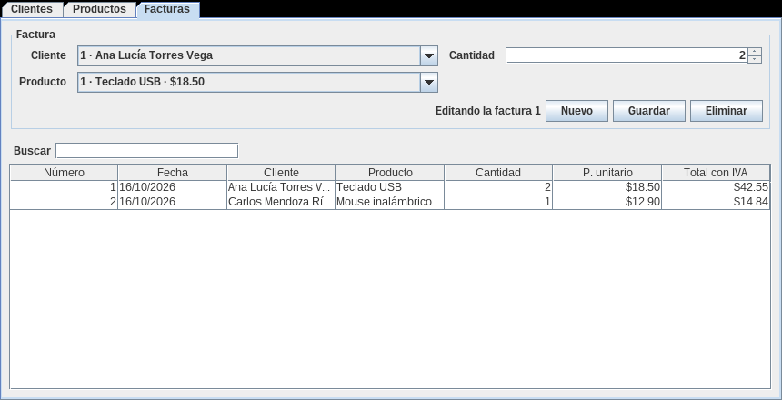
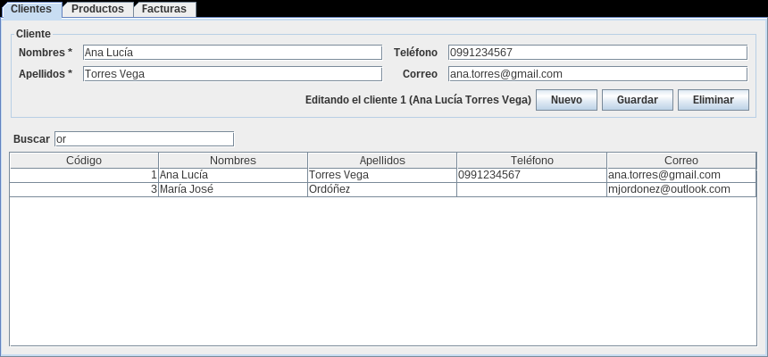

# java-crud-facturas

[](https://github.com/Whiteherobot/java-crud-facturas/actions/workflows/ci.yml)

CRUD de clientes, productos y facturas en Java Swing con `JTable`. Es la segunda
parte del ejercicio de facturación de Programación Orientada a Objetos (junio
de 2022), en grupo, cuyo tema era modificar y eliminar registros. La primera
parte, centrada en emitir facturas, está en
[java-facturacion-jtable](https://github.com/Whiteherobot/java-facturacion-jtable).



Las tres pestañas funcionan igual:

- **Seleccionar** una fila carga el registro en el formulario.
- **Guardar** registra uno nuevo o modifica el seleccionado. **Nuevo** limpia
  el formulario.
- **Eliminar** pide confirmación.
- **Buscar** filtra la tabla mientras se escribe, en cualquier columna.

Las reglas que mantienen los datos consistentes:

- No se puede eliminar un cliente o un producto que aparece en una factura.
- Crear una factura descuenta el stock. Modificarla lo ajusta por la diferencia,
  incluso si se cambia de producto, y eliminarla lo devuelve. Si no alcanza el
  stock, no se modifica nada.
- La factura guarda el precio del momento de la venta: cambiar después el
  precio del producto no altera las facturas emitidas.
- Los códigos no se reutilizan, aunque se eliminen registros.



## Cómo correrlo

Necesitas JDK 17 o superior. El proyecto trae el wrapper de Maven.

```bash
./mvnw verify                            # compila y corre las pruebas
java -jar target/crud-facturas-1.0.0.jar
```

## Estructura

```
src/main/java/crud/
├── modelo/       Cliente, Producto y Factura (registros inmutables con validación)
├── servicio/     Repositorio genérico en memoria y Tienda (stock e integridad)
├── controlador/  Un controlador por entidad
└── vista/        PanelCrud (formulario + JTable con búsqueda) y un panel por entidad
```

Las tres pantallas comparten `PanelCrud`, que resuelve la selección, el modo
nuevo/edición, la confirmación y el filtro; cada panel solo define sus campos.
Las pruebas cubren las reglas de stock e integridad y el uso de los paneles, y
corren en GitHub Actions con Java 17 y 21.

## Qué cambió desde la entrega

La versión de 2022 dependía de un artefacto local del curso, así que no
compilaba en otra máquina. Además, la búsqueda de posición devolvía la última
fila cuando el código no existía, de modo que modificar un código inexistente
sobrescribía el último registro. `Producto` tenía dirección pero no precio ni
stock. En 2026 se rehízo con la misma división en capas, se corrigió el CRUD y
se agregaron las reglas de integridad. La imagen de fondo de la entrega se
quitó por no tener una licencia clara.

## Autores

- Michael Lata ([@Whiteherobot](https://github.com/Whiteherobot))
- Gabriela Rocano

Licencia MIT.
